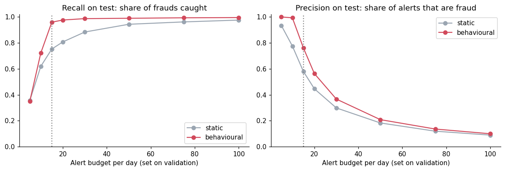
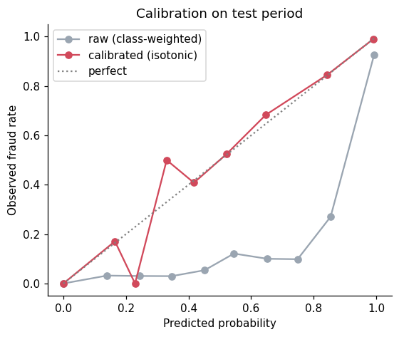
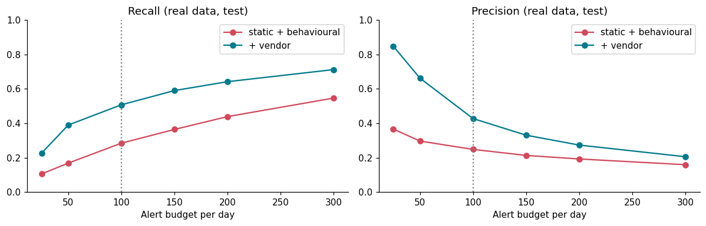

# Card Fraud Early Warning

**A fraud team can only review a fixed number of transactions a day. Which ones should it review, and how fast does a stolen card get stopped?**

This project treats fraud detection as a decision problem, not a leaderboard score, and tests the same method twice: on synthetic data, then on real transactions.


---

## Contents

- [Results at a glance](#results-at-a-glance)
- [What makes this different](#what-makes-this-different)
- [Part 1: synthetic data](#part-1-synthetic-data)
- [Part 2: real data (IEEE-CIS)](#part-2-real-data-ieee-cis)
- [Making sure the numbers can be trusted](#making-sure-the-numbers-can-be-trusted)
- [How I'd take it to production](#how-id-take-it-to-production)
- [Limitations](#limitations)
- [Quick start](#quick-start)
- [Repository structure](#repository-structure)
- [Data sources](#data-sources)

---

## Results at a glance

| | Part 1: synthetic | Part 2: real (IEEE-CIS) |
|---|---|---|
| Transactions | 1.85M (2019–2020) | 590k (6 months) |
| Best test PR-AUC | 0.97 | **0.49** |
| Precision / recall at the daily alert budget | 0.76 / 0.96 | **0.43 / 0.51** |
| Gain from my behavioural features (test PR-AUC) | +0.22 (0.74 → 0.97) | **+0.01** (0.185 → 0.199) |
| Median history per card/account | ~2,000 transactions | **1 transaction** |
| Alert budget held on the test period? | Yes (12.7 vs 15/day) | **No** (119 vs 100/day) |
| Calibration needed? | Yes (class weights inflated scores) | No (checked) |

**Key takeaways**

- **The synthetic score was never the point.** On real data PR-AUC halves. A benchmark that looks easy usually is.
- **My behavioural features didn't transfer.** They drove the synthetic results and added almost nothing on real data, where the median account has one transaction in six months. Vesta's own network-wide features carry 64% of the real model's signal. *Where history is recorded matters more than how cleverly it's engineered.*
- **The methods did transfer**, and on real data they found real problems: the alert budget overshot by 19%, and one product line (`W`) has recall of only 0.21 because its device data is mostly missing.

---

## What makes this different

| Typical fraud notebook | This project |
|---|---|
| Random train/test split | **Time-based split**: train on the past, test on the future |
| Trusts the data | **SQL data audit first**. It rejected my first dataset (see below) |
| Hopes features don't leak | **pytest suite proves features use only past data**, checked by planting a leak |
| Threshold of 0.5 | Threshold set by **analyst capacity** (alerts per day) |
| Transaction-level metrics only | Plus **time-to-detection per stolen card** |
| Point estimates | **Card-level bootstrap** confidence intervals |
| SMOTE by default | Class weights compared; SMOTE rejected because it invents impossible card histories |
| Global SHAP chart | **Plain-English reason codes** for every alert |
| Synthetic results only | **Re-tested on real data**, with an honest account of what didn't hold up |

---

## Part 1: synthetic data

**Notebook:** [`notebooks/fraud_early_warning.ipynb`](notebooks/fraud_early_warning.ipynb)

**Data:** 1.85M card transactions, 999 cards, 0.52% fraud, generated with the Sparkov simulator. Named fields: time, amount, merchant, category, card, locations.

**Setup:** train Jan 2019–Mar 2020, validate Apr–Jun 2020, test Jul–Dec 2020. The alert threshold is set on validation data to produce **15 alerts/day**, then applied unchanged to the test period.

### Results (test set, 1,861 frauds)

| | Transaction-only features | + Card behaviour features |
|---|---|---|
| **Precision** | 0.58 (0.54–0.62) | **0.76** (0.73–0.79) |
| **Recall** | 0.75 (0.72–0.78) | **0.96** (0.95–0.97) |
| PR-AUC | 0.74 | 0.97 |
| False alarms | 1,013 | **557** (−45%) |
| Fraud $ missed | $114,414 | **$18,918** (−83%) |

95% intervals from a card-level bootstrap. Frauds within one stolen-card episode are linked, so resampling single transactions would make the intervals look falsely narrow.



### Per stolen card (188 fraud episodes)

A stolen card is used ~10 times over ~2 days. Catching the first transaction beats catching the tenth.

| | Transaction-only | Behavioural |
|---|---|---|
| Stolen cards detected | 97.9% | **100%** |
| Caught on the first fraudulent transaction | 81.9% | **86.7%** |
| $ lost before the first alert | $16,288 | **$7,444** |

### Model comparison (validation PR-AUC)

| Model | PR-AUC |
|---|---|
| Logistic regression, behavioural features | 0.667 |
| XGBoost, transaction-only features | 0.800 |
| XGBoost, behavioural, no class weights | 0.975 |
| **XGBoost, behavioural, class weights** | **0.979** |

XGBoost earns its complexity: the signal sits in combinations (large amount *and* late night *and* a burst of activity) that a linear model can't capture without hand-built interactions.

**Feature-group ablation:** I removed one group at a time and retrained. Velocity (transaction counts and $ in the last 1h/24h/7d) is the group the model can't do without (−0.035 PR-AUC). Every other group costs under 0.01, because they overlap.

### From scores to decisions

**Calibration.** Class weights inflate scores: transactions scored ~0.75 turn out to be fraud only ~10% of the time. Isotonic calibration fixes this and halves the Brier score (0.0009 → 0.0004).



**Expected-loss ranking is a trade-off, not a free win.**

| At 15 alerts/day | Rank by probability | Rank by expected $ loss |
|---|---|---|
| Frauds missed | **75** | 296 |
| Fraud $ missed | $18,918 | **$10,893** |
| Precision | **0.76** | 0.66 |

Ranking by expected loss cuts missed fraud value by ~40% but misses 4× as many frauds. Small frauds are often card testing before a big purchase, so this is a business decision, not a modelling one.

### What the model misses

The 75 missed frauds look like normal spending: median $51 (vs $364 for caught frauds), at the card's usual amount, and a third are the first fraud of an episode. That's the card-testing pattern. Catching it needs data this set doesn't have, such as device or card-present flags.

### Analyst queue with reason codes

Every alert gets its top three reasons in plain English, from SHAP values. Sample day: [`outputs/alert_queue_sample.csv`](outputs/alert_queue_sample.csv)

| Time | Amount | Category | Reason 1 | Reason 2 | Fraud |
|---|---|---|---|---|---|
| 23:01 | $1,133.57 | shopping_net | Amount $1,134 is in a high-risk range | $3,179 already spent on this card in the past 24h | yes |
| 01:48 | $335.98 | grocery_pos | Category 'grocery_pos' carries higher fraud risk | Amount $336 is 4.0x this card's 30-day average | yes |

---

## Part 2: real data (IEEE-CIS)

**Notebook:** [`notebooks/real_data_ieee.ipynb`](notebooks/real_data_ieee.ipynb)

**Data:** 590,540 real e-commerce card transactions from Vesta, 6 months, 3.5% fraud. It has no card ID and many anonymised columns, and its labels follow a business rule: after a chargeback, linked later transactions are also marked fraud.

**Same method, adapted:**

- **Reconstructed account ID:** `card1` + billing region + account start day (transaction day − `D1`). It's used to build features, but not given to the model, so the model can't memorise accounts.
- **Past-only behavioural features in SQL** ([`sql/features_ieee.sql`](sql/features_ieee.sql)), with their own leakage tests.
- **Time split:** train days 0–119, validate 120–149, test 150–182. Budget: 100 alerts/day.

| Features (test set) | PR-AUC | New accounts | Accounts with history |
|---|---|---|---|
| Static (named fields) | 0.185 | 0.213 | 0.167 |
| + my behavioural features | 0.199 | 0.221 | 0.182 |
| Static + Vesta's features (C, D, M) | **0.491** | 0.528 | 0.449 |
| All three | 0.488 | 0.523 | 0.445 |

At 100 alerts/day: **precision 0.43 (0.39–0.46), recall 0.51 (0.47–0.54)**, with an account-level bootstrap. The threshold produced 119 alerts/day instead of 100.



**Checks that matter on real data:**

- **The model isn't exploiting the labelling rule.** 61% of frauds follow an earlier fraud on the same account, yet recall is *higher* on first frauds (0.57) than on follow-ons (0.47).
- **Where it fails:** product `W` (42% of test frauds) has recall 0.21. Missed frauds mostly lack device data (33% have it, vs 81% of caught frauds). The fix is data capture, not modelling.
- **Calibration wasn't needed here**, because no class weights were used. Same check as Part 1, opposite conclusion.

---

## Making sure the numbers can be trusted

**The audit rejected my first dataset.** A larger Sparkov dataset (2021–2023) gave 0.93 PR-AUC, then failed the audit. In 2023 no legitimate purchase happened before noon, and whole categories existed only in certain half-years. The model was learning the simulator's bugs, so I dropped the dataset.

| Audit check (dataset used) | Result | Action |
|---|---|---|
| Time-of-day pattern stable across years | Pass | Keep hour features |
| Every category present in every period | Pass | — |
| Every card has normal history | **Fail**: 91 cards are fraud-only | Excluded |
| Cardholder age/gender/city | Near-unique fingerprint for ~900 cards | Excluded, to stop the model memorising cards |

**No look-ahead in features.** Behavioural features use each card's *earlier* transactions only (DuckDB `RANGE ... EXCLUDE GROUP` windows), never past fraud labels. Tests check that:

1. Rewriting all future data leaves past features unchanged.
2. A brute-force pandas recomputation matches the SQL output.
3. A deliberately planted 1-hour look-ahead bug makes the tests fail, on both datasets.

**Monitoring.** On synthetic data, a fixed threshold stayed at 10–16 alerts/day for six months. Recalibrating monthly chased noise and cut December precision from 0.70 to 0.53. On real data, the budget overshot by 19%. Recommendation: a fixed threshold plus an alert-volume alarm.

---

## How I'd take it to production

1. **Shadow mode** for 4–6 weeks: score live traffic, log alerts, don't act.
2. **Champion/challenger**, with a small share of traffic kept on the old system.
3. **Weekly monitoring**: alert volume, analyst-confirmed precision, score drift (PSI).
4. **Retraining** that waits for chargeback labels to mature (30–60 days).
5. **A small random unalerted sample**, so future training data isn't shaped only by the model's own past decisions.

---

## Limitations

- **Part 1 is synthetic and easy.** Part 2 exists because of this.
- **Part 2 uses a reconstructed account ID** and a 6-month window. With full account history, behavioural features might do better. That's untested here.
- **IEEE-CIS features are partly anonymised**, so SHAP can say *C13 matters* but not what C13 means.
- **"$ lost before first alert"** assumes instant review and blocking, so treat the savings as an upper bound.
- **Alert budgets (15/day, 100/day) are assumptions.** The budget curves show other options.

---

## Quick start

```bash
git clone https://github.com/<your-username>/card-fraud-early-warning.git
cd card-fraud-early-warning
python -m venv .venv && source .venv/bin/activate   # Windows: .venv\Scripts\activate
pip install -r requirements.txt

# Part 1: synthetic data (downloads ~500 MB, no account needed)
make data        # download + remove PII-like fields
make features    # build point-in-time features with DuckDB (~10 s)
make test        # leakage tests
make notebook    # run the Part 1 analysis (~10 min)

# Part 2: real data (Kaggle account needed; accept the competition rules first)
kaggle competitions download -c ieee-fraud-detection -p data/raw/ieee
unzip data/raw/ieee/ieee-fraud-detection.zip -d data/raw/ieee
make ieee        # prepare, build features, test, run the Part 2 notebook (~8 min)
```

No `make` on Windows? Run the commands under each target in the [`Makefile`](Makefile) directly, e.g. `python src/download_data.py`.

The notebooks are committed with their outputs, so you can read every result on GitHub without running anything.

---

## Repository structure

```
card-fraud-early-warning/
├── notebooks/
│   ├── fraud_early_warning.ipynb   # Part 1: synthetic data (with outputs)
│   ├── fraud_early_warning.py      # same notebook as a plain script (jupytext)
│   ├── real_data_ieee.ipynb        # Part 2: real data (with outputs)
│   └── real_data_ieee.py
├── sql/
│   ├── features.sql                # point-in-time features, synthetic data
│   └── features_ieee.sql           # point-in-time features, real data
├── src/
│   ├── download_data.py            # download synthetic data, drop PII-like fields
│   ├── prepare_ieee.py             # prepare real data, build account ID
│   ├── build_features.py           # run the SQL with DuckDB
│   └── reason_codes.py             # SHAP values -> plain-English alert reasons
├── tests/                          # leakage tests (skip if data isn't downloaded)
├── figures/                        # all charts used in this README
├── outputs/alert_queue_sample.csv  # one day's analyst queue
├── data/README.md                  # how to get the data (data itself is not committed)
├── Makefile
├── requirements.txt
└── LICENSE
```

---

## Data sources

| Dataset | Source | Licence |
|---|---|---|
| Synthetic card transactions (Sparkov) | [Kaggle: kartik2112/fraud-detection](https://www.kaggle.com/datasets/kartik2112/fraud-detection) · [Hugging Face mirror](https://huggingface.co/datasets/NeerajCodz/creditCardFraudDetection) | CC0 |
| IEEE-CIS Fraud Detection (Vesta) | [Kaggle competition](https://www.kaggle.com/competitions/ieee-fraud-detection/data) | Kaggle competition rules |

Neither dataset is included in this repository.

---

## Author

**Rohith Suresh Raj**, MSc Data Science and Statistical Learning, University of Limerick
[LinkedIn](https://www.linkedin.com/in/rohith-suresh-raj-186804263)
